# WiraWiri Feeder Suroboyo: Operations Dashboard and Fleet Decision Support

A desktop web interface that helps a city transport agency decide **which feeder-bus corridor should get extra buses first, and explain why.**
It combines daily operations monitoring with a Decision Support System based on **Simple Additive Weighting (SAW)**, and every part of the calculation can be traced on screen.


| | |
|---|---|
| **Role** | UI/UX designer and decision analyst (solo) |
| **Context** | Course project, Decision Support Systems, Department of Mathematics, Institut Teknologi Sepuluh Nopember (ITS), 2026 |
| **Scope** | 7 pages + 4 sub-views, desktop 1280 px, high-fidelity in Figma |
| **Decision model** | SAW, 5 corridors × 6 criteria, plus weight-sensitivity analysis |
| **Evaluation** | Heuristic inspection against Nielsen's 10 usability heuristics |
| **Deliverables** | [Report (PDF, Indonesian)](report/laporan-wirawiri-spk-saw.pdf) · [Figma file](https://www.figma.com/design/gAYZEz2JXkJzd2NWhkJvwu/Dashboard-SPK--Copy-?node-id=0-1) · [SAW script](analysis/saw.py) · [SAW spreadsheet](analysis/saw_model.xlsx) · [Design decision log](docs/design-decisions.md) |

> **Note:** This is an academic concept. It is not affiliated with or endorsed by Dinas Perhubungan Kota Surabaya. All operational data is simulated, and the names shown in the UI are fictional.

---

## The problem

WiraWiri Suroboyo is Surabaya's feeder-bus service, connecting neighbourhoods to the main transit network. When demand on a corridor outgrows its fleet, people feel it directly: full buses, long waits, more complaints.

Deciding where to add buses is slow because the data sits in separate places: ridership, bus load, waiting time, complaints, and fleet availability. Planners merge it by hand, and the decision maker is still left asking *"why this corridor first?"*

Dashboards and decision models usually live apart. Dashboards stop at showing numbers, and SAW calculations stay in spreadsheets that managers don't read. This project puts both in **one workflow**: monitor → verify → decide → document.

## Users

| Actor | Needs | Main pages |
|---|---|---|
| **Transport Planner** (primary, daily user) | Monitor corridor performance, compare data, draft fleet proposals | Dashboard, Data Koridor, Rekomendasi |
| **Kepala Bidang Angkutan** (decision maker) | Understand the recommendation and its reasons, approve it | Rekomendasi, Laporan |
| **Admin Depo** | Keep bus status up to date (operating, maintenance, reserve) | Data Koridor |

## Process

The design follows Garrett's five planes of user experience, then adds the decision model and an evaluation step.

| # | Stage | Output |
|---|---|---|
| 1 | Reference study of Dishub Surabaya's website and visual identity | Navigation patterns, visual style |
| 2 | Requirements analysis | 3 actor profiles |
| 3 | Information architecture | Menu grouped by work stage |
| 4 | Design system | Colours, type, components |
| 5 | High-fidelity design | 7 pages + 4 sub-views in Figma |
| 6 | SAW implementation | Decision matrix, ranking, sensitivity analysis |
| 7 | Evaluation | Nielsen heuristic inspection |

## User flow

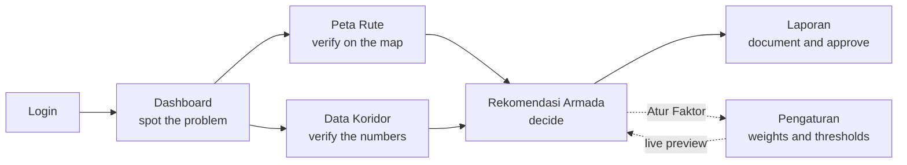

Each page links to the next step (for example, "Lihat Rekomendasi" on the Dashboard), so users can follow the whole flow without going back to the menu.

## Key design decisions

The full log, with the alternatives considered and the reasoning, is in [docs/design-decisions.md](docs/design-decisions.md).

| Decision | Why |
|---|---|
| The recommendation page opens with the conclusion, **"Tambah 7 unit armada"** (add 7 buses), before any table | The decision maker is not technical and needs the answer first, details second |
| A **"Why is A4 most in need?"** panel and a visible weights panel | Avoids a black-box recommendation; the reasons are on the same screen as the result |
| **SAW** rather than AHP or TOPSIS | It is a weighted sum, so every part of it can be shown and explained in the UI |
| Show a 0–100 **need score** instead of V = 0.9667 | Easier to read and compare at a glance |
| The number of buses is an **analyst input** within a category range, not SAW output | SAW ranks need; it does not size the fleet |
| Status shown by **colour and a text label** (Kritis / Waspada / Normal) | Traffic-light colours are familiar in transport, and the labels keep it readable for colour-blind users (WCAG 2.1) |
| Navigation grouped by **work stage**: Summary, Data, Decision, Other | Mirrors how a planner thinks: overview → check → decide → document |
| Every KPI has a **target or comparison** next to it | A number alone does not say whether it is good or bad |
| **One simulated dataset** used consistently on every screen | Numbers can be checked by hand (2,090 passengers = sum of C1; 23.6 min = mean waiting time) |

## Screens

| | |
|---|---|
| 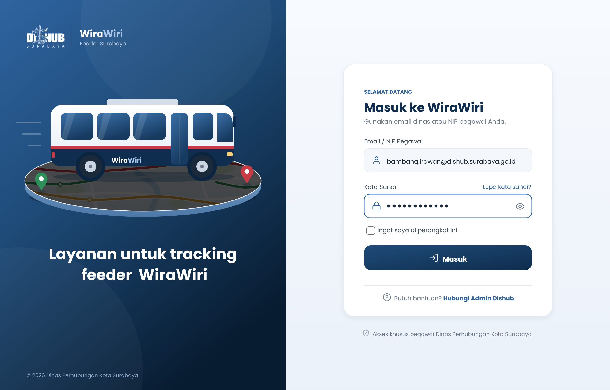 **Login**: animated intro (the bus pulls up onto the route map), staff-only access with official email or NIP, show/hide password | 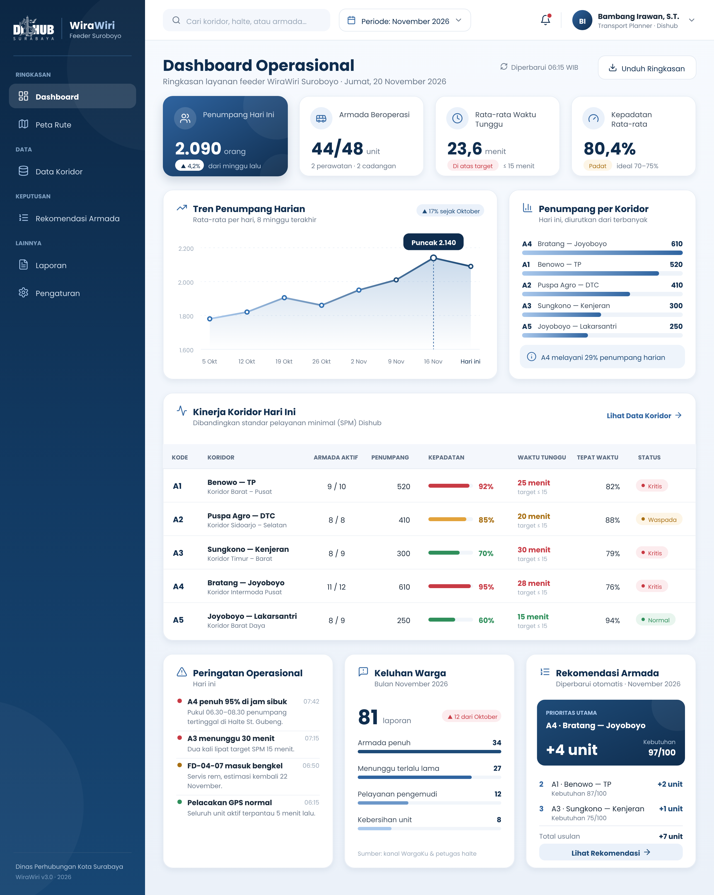 **Dashboard**: KPIs with targets, 8-week trend, corridor performance vs. service standard, alerts, recommendation preview |
| 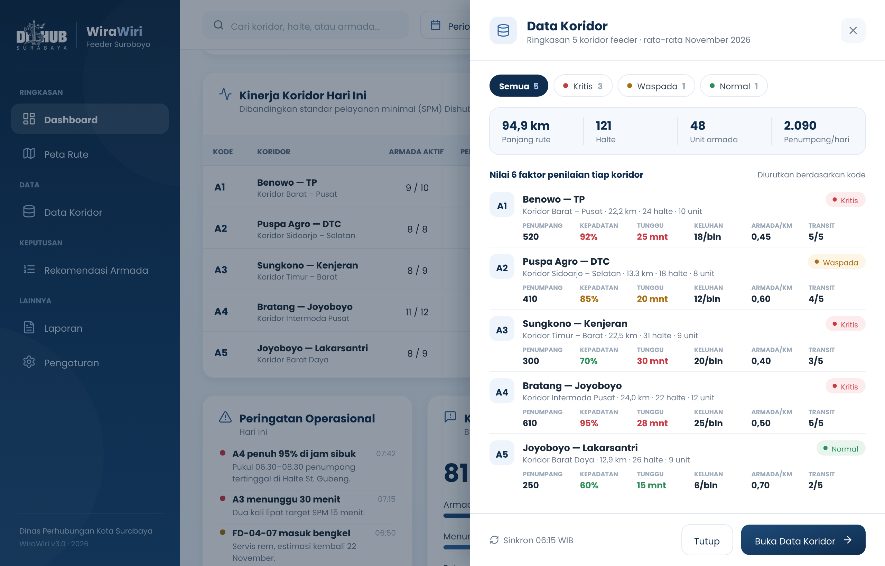 **Slide-over: corridor data**: six criteria per corridor without leaving the Dashboard | 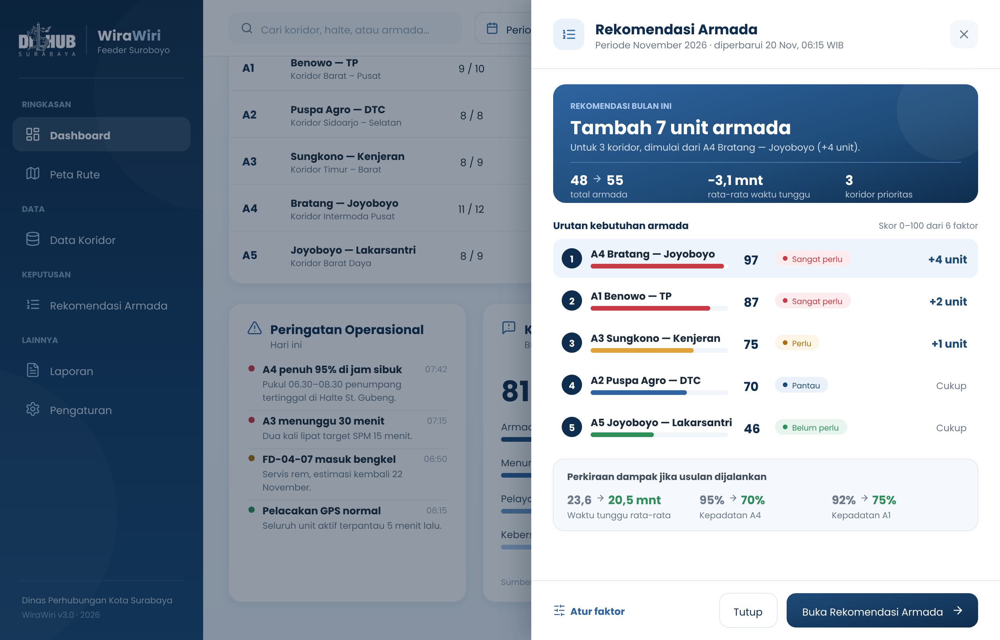 **Slide-over: recommendation**: ranking and expected impact |
| 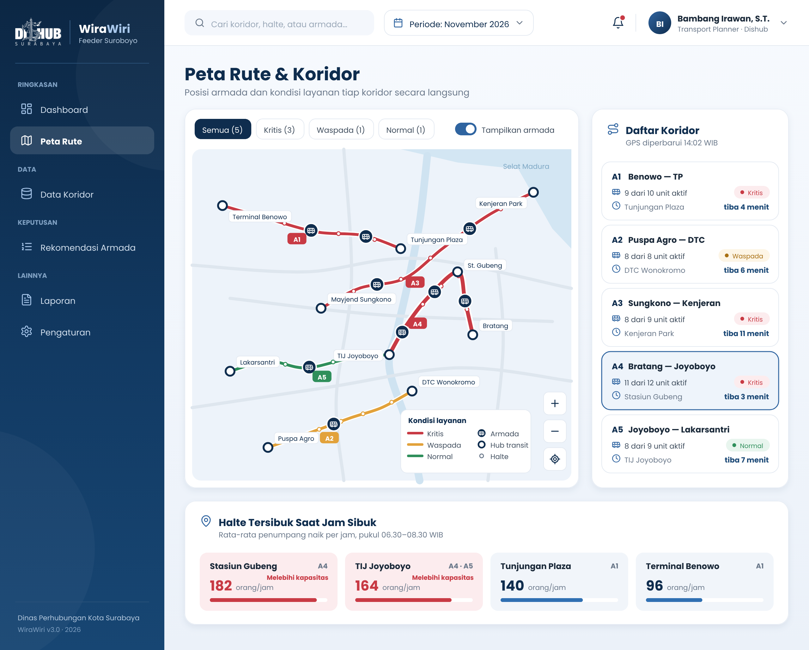 **Peta Rute**: schematic map coloured by service status, with segment filters | 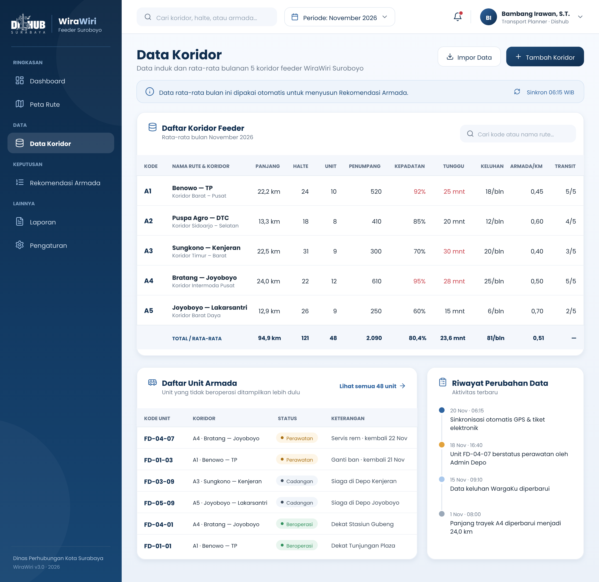 **Data Koridor**: master data; six columns are the SAW decision matrix |
| 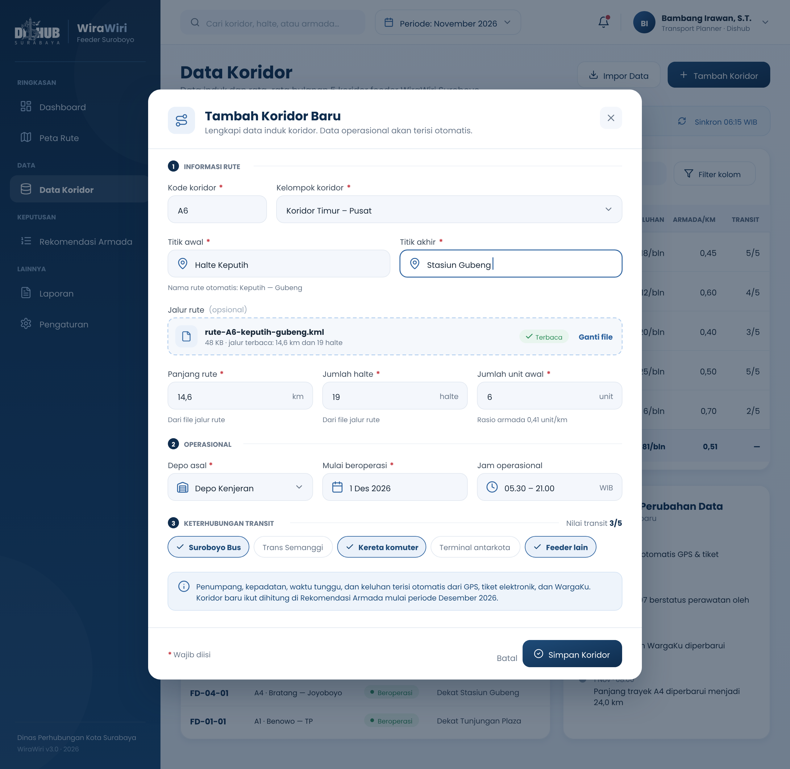 **Add corridor**: three-step form, auto-fill from the route file, required-field markers | 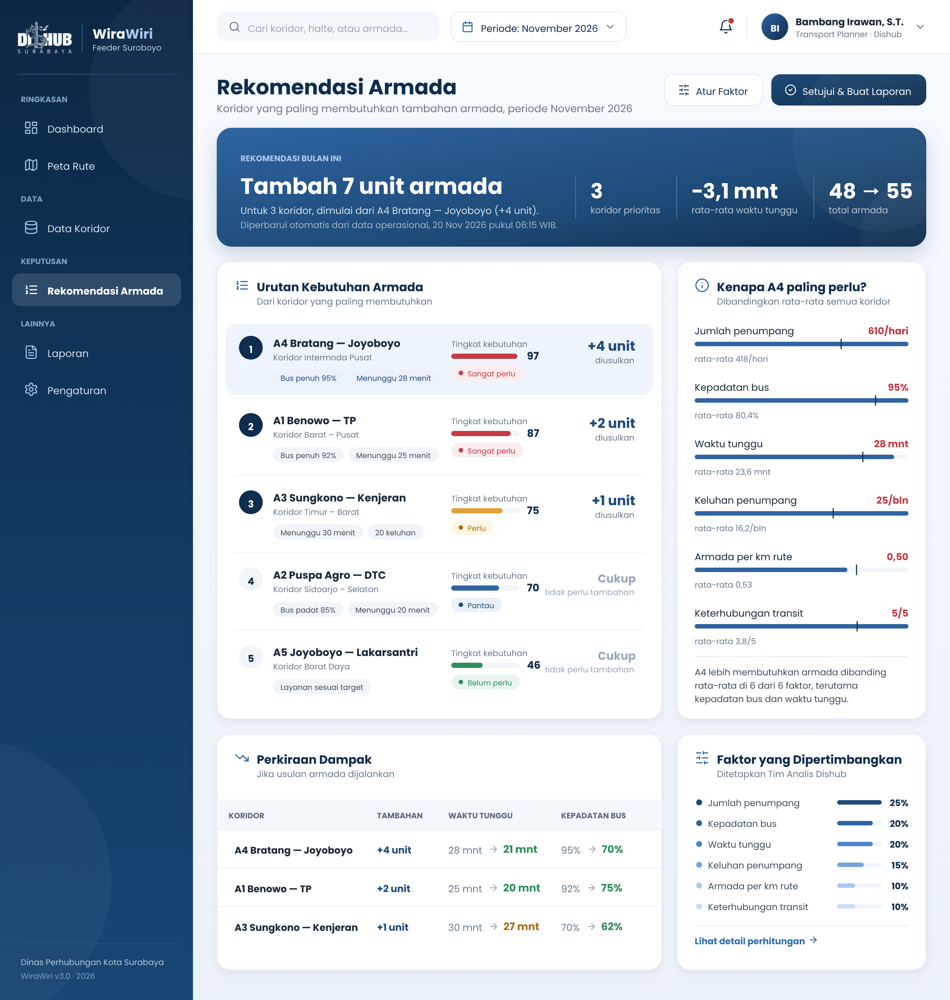 **Rekomendasi Armada**: the core of the DSS, with conclusion, ranking, reasons, weights and expected impact |
| 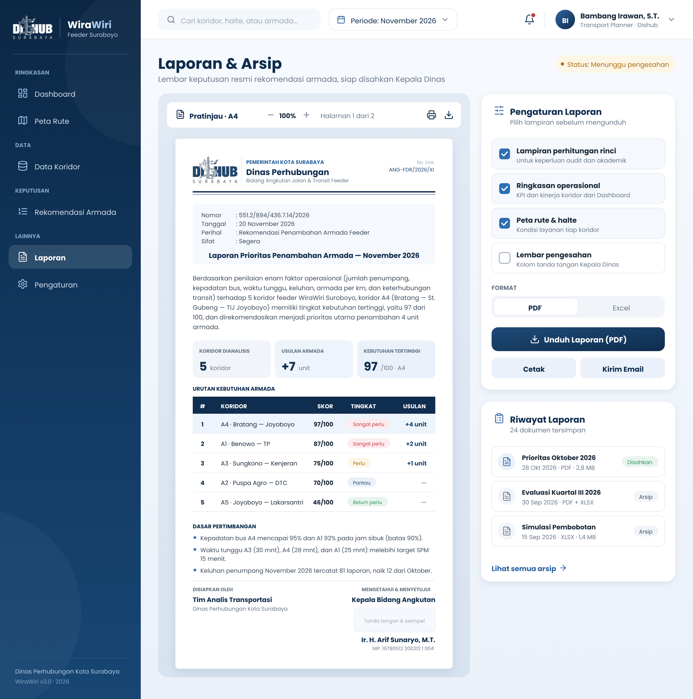 **Laporan**: official decision sheet ready for approval, PDF/Excel export | 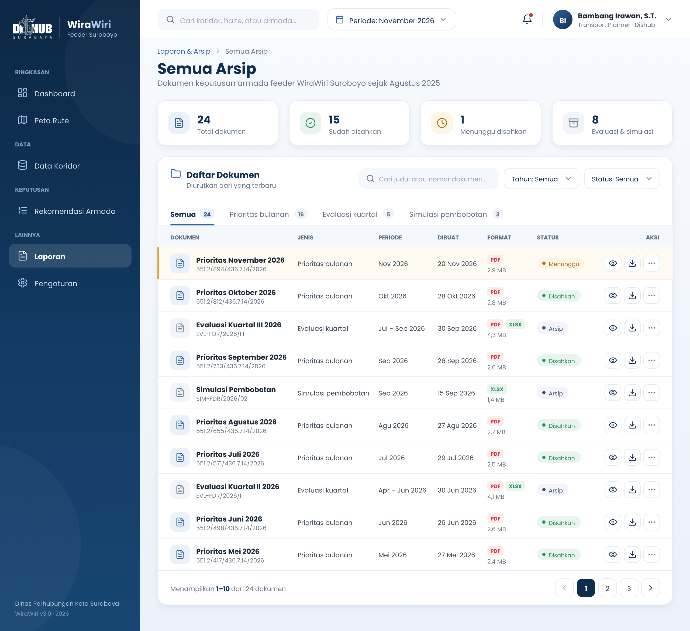 **Archive**: all decision documents with status and type filters |
| 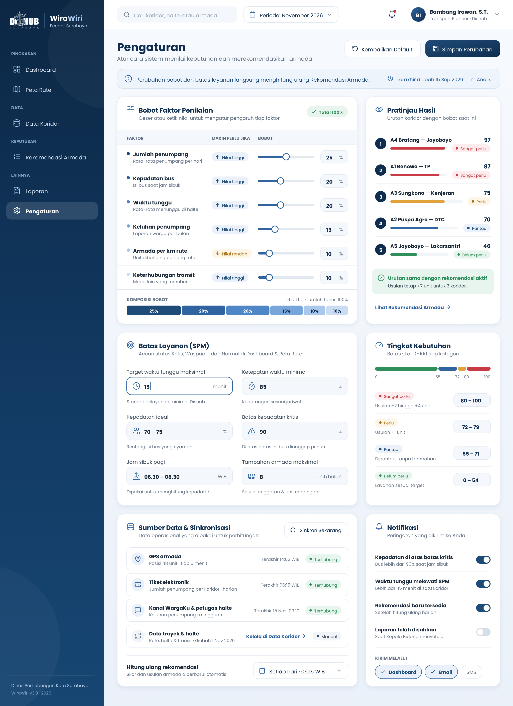 **Pengaturan**: weight sliders with live result preview, service thresholds, score categories, data sources | |

Source SVGs are in [`design/svg/`](design/svg). The layouts use [Poppins](https://fonts.google.com/specimen/Poppins).

## Decision model: Simple Additive Weighting

**Alternatives**: five corridors (A1 Benowo–TP, A2 Puspa Agro–DTC, A3 Sungkono–Kenjeran, A4 Bratang–Joyoboyo, A5 Joyoboyo–Lakarsantri).

**Criteria and weights**: the goal is to measure *need* for more buses, so a higher value means more need. The one exception is C5: a **low** fleet-per-km ratio means the corridor is short of buses, so C5 is a cost criterion.

| Code | Criterion | Weight | Type |
|---|---|---|---|
| C1 | Passengers (people/day) | 0.25 | Benefit |
| C2 | Bus load at peak (%) | 0.20 | Benefit |
| C3 | Waiting time (min) | 0.20 | Benefit |
| C4 | Complaints (reports/month) | 0.15 | Benefit |
| C5 | Fleet per route km (units/km) | 0.10 | Cost |
| C6 | Transit connectivity (1–5) | 0.10 | Benefit |

Normalisation: $r_{ij} = x_{ij} / \max_i x_{ij}$ for benefit criteria and $r_{ij} = \min_i x_{ij} / x_{ij}$ for cost criteria. Preference value: $V_i = \sum_j w_j r_{ij}$.

**Result**

| Rank | Corridor | V | Score | Category | Proposal |
|---|---|---|---|---|---|
| 1 | A4 Bratang–Joyoboyo | 0.9667 | 97 | Sangat perlu (urgent) | +4 units |
| 2 | A1 Benowo–TP | 0.8704 | 87 | Sangat perlu (urgent) | +2 units |
| 3 | A3 Sungkono–Kenjeran | 0.7503 | 75 | Perlu (needed) | +1 unit |
| 4 | A2 Puspa Agro–DTC | 0.6990 | 70 | Pantau (monitor) | – |
| 5 | A5 Joyoboyo–Lakarsantri | 0.4619 | 46 | Belum perlu (not yet) | – |

Score categories (set on the Pengaturan screen): 80–100 Sangat perlu, 72–79 Perlu, 55–71 Pantau, 0–54 Belum perlu.

### Sensitivity analysis: the ranking holds, the allocation is less certain

The weights come from the analyst team's judgement, so they are subjective. To test how robust the result is, one weight is changed at a time and the rest are rescaled proportionally: $w'_j = w_j \frac{1 - w'_k}{1 - w_k}$.

| Scenario | Change | Ranking | V(A4) | Score A3 / A2 |
|---|---|---|---|---|
| S0 | Base weights | A4 › A1 › A3 › A2 › A5 | 0.9667 | 75 / 70 |
| S1 | Equal weights (1/6) | A4 › A1 › A3 › A2 › A5 | 0.9556 | 77 / 70 |
| S2 | C1 raised to 0.35 | A4 › A1 › A3 › A2 › A5 | 0.9711 | **72** / 70 |
| S3 | C3 raised to 0.30 | A4 › A1 › A3 › A2 › A5 | 0.9625 | 78 / 69 |
| S4 | C4 removed | A4 › A1 › A3 › A2 › A5 | 0.9608 | 74 / **74** |
| S5 | C5 raised to 0.20 | A4 › A1 › A3 › A2 › A5 | 0.9481 | 78 / 70 |

The **ranking never changes**, so the priority for A4 and A1 is safe to act on. The **decision for A3 and A2 is less certain.** Both sit near the 72-point boundary of the Perlu category:

- In S2, A3 drops to exactly 72.
- In S4, A2 rises to 74 and joins the Perlu category. It is only 0.0039 behind A3 in preference value, so it would also qualify for an extra bus.

The UI should therefore flag corridors whose score is close to a category boundary, and leave those calls to the decision maker. This is the main improvement planned for the next iteration.

### Reproduce it

```bash
python analysis/saw.py        # Python 3.8+, standard library only
```

The script prints Tables VII–IX of the report and writes [`analysis/results/`](analysis/results). The same model is in [`analysis/saw_model.xlsx`](analysis/saw_model.xlsx) with live formulas: change a weight or a matrix value on the *Inputs* sheet, and the ranking and sensitivity sheets recalculate.

## Traceability: no black box

Every SAW component appears on a specific UI element, so a sceptical manager can trace a recommendation back to the raw data.

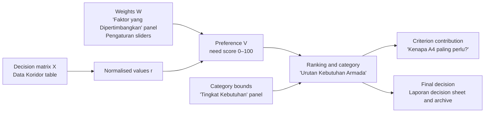

## Evaluation

The design was inspected against Nielsen's 10 usability heuristics. **6 are fully met and 4 are partly met.**

| Partly met | Gap | Planned fix |
|---|---|---|
| Error prevention | No confirmation before "Setujui & Buat Laporan" (approve and create report) | Confirmation dialog summarising what will be approved |
| Help users recover from errors | No error messages for invalid form input | Inline validation states for the Add Corridor and Login forms |
| Flexibility and efficiency | Desktop only | Responsive layout for field staff |
| Help and documentation | No help page | Help centre and glossary of criteria |

## Limitations

- All data is simulated, and the evaluation was a heuristic self-inspection, not testing with real users.
- The weights reflect the analyst team's judgement. The sensitivity analysis bounds this risk but does not remove it.
- The number of buses per corridor is an analyst input. SAW only ranks the corridors by need.

## Next steps

1. Usability testing with Dishub staff using the System Usability Scale (SUS).
2. Flag scores near a category boundary and add a scenario-simulation mode that does not change the active weights.
3. Fix the four partly met heuristics.
4. Replace simulated data with GPS and e-ticket feeds.

## Design system

| Element | Specification |
|---|---|
| Primary colours | Navy `#0F2D4E`, blue `#2F64A0`, text `#1B2A3A`, background `#F1F5FA` |
| Status colours | Red `#C83A44` Kritis, amber `#E2A23B` Waspada, green `#2F8F5B` Normal |
| Typography | Poppins: page title 28 px bold, card title 16 px, body 13–14 px |
| Components | KPI card, status chip, data table, progress bar, button, segmented filter, slide-over panel, modal form, checkbox and password-visibility toggle (with state variants) |
| Layout | 1280 px frame, 260 px sidebar, 72 px header, card-based content |

## Repository structure

```
.
├── README.md                     case study (this file)
├── docs/
│   ├── design-decisions.md       decision log: context, options, choice, rationale
│   └── hero.png
├── design/
│   ├── screens/                  PNG exports of every screen (2x)
│   └── svg/                      source SVGs (text outlined; Login has two animation frames)
├── analysis/
│   ├── saw.py                    reproducible SAW and sensitivity analysis
│   ├── saw_model.xlsx            the same model with live Excel formulas
│   ├── data/                     decision matrix and criteria (CSV)
│   └── results/                  generated outputs (CSV)
└── report/
    ├── laporan-wirawiri-spk-saw.pdf    full report (Indonesian)
    └── laporan-wirawiri-spk-saw.docx
```

## Author

**Raychana Maharani Zahra**, Department of Mathematics, Institut Teknologi Sepuluh Nopember.

The Dishub Surabaya logo and name are used only to make this academic mock-up realistic. Poppins is licensed under the SIL Open Font License.
